# PaperLibrary HELIX · 本地文献库

PaperLibrary HELIX 是一个**跑在自己电脑上的文献管理工具**：把散落在文件夹里的 PDF 收进来，自动识别题录，并按磁盘目录自动分类；支持题录与全文检索、内嵌阅读、AI 中文总结、图表提取、多篇横向对比，以及 GB/T 7714、APA、BibTeX 等格式的引用导出。

它不注册账号、不上传云端，所有数据只放在程序目录的 `data/` 里；**不联网也能完成入库、检索、阅读、标注和导出**。联网与大模型是可选项：配好 API Key 才有 AI 总结、对话与联网检索。

- 当前版本：以程序内「设置与备份 → 关于」和根目录 `version.json` 为准
- 适用系统：Windows 10（10.0.17763 及以上）/ Windows 11，64 位
- 下载地址：[GitHub Releases](https://github.com/PaperLibrary-Developers/PaperLibrary/releases)（下载最新发布里的 `PaperLibrary.*.HELIX.zip`，约 42 MB）
- 开源许可：AGPL-3.0

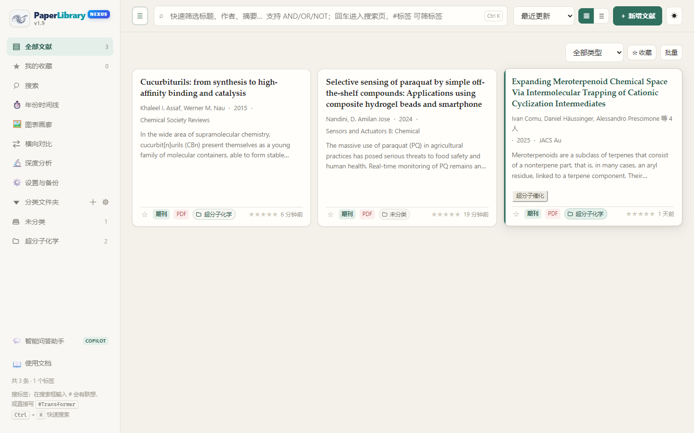

> **只想先跑通？** 五步即可：解压 → 双击 `PaperLibrary.exe` → `＋ 新增文献` 拖入一个 PDF → 核对卡片点 `导入这篇` → 点开这篇文献看原文、生成总结、复制引用。下面的章节会逐项解释每个按钮。

---

## 目录

1. [它解决什么问题](#1-它解决什么问题)
2. [功能一览](#2-功能一览)
3. [安装与启动](#3-安装与启动)
4. [从源码运行（开发者）](#4-从源码运行开发者)
5. [第一次打开：界面导览](#5-第一次打开界面导览)
6. [导入文献](#6-导入文献)
7. [整理与分类](#7-整理与分类)
8. [检索](#8-检索)
9. [读一篇文献](#9-读一篇文献)
10. [引用与导出](#10-引用与导出)
11. [图表、对比与深度分析](#11-图表对比与深度分析)
12. [设置、备份与更新](#12-设置备份与更新)
13. [智能问答助手与使用文档](#13-智能问答助手与使用文档)
14. [数据、备份与隐私](#14-数据备份与隐私)
15. [常见问题](#15-常见问题)
16. [版本与许可](#16-版本与许可)

---

## 1. 它解决什么问题

做研究时 PDF 往往散在「下载」和十几个命名随意的文件夹里：找一篇旧文献要翻半天；读过的内容记不住；写论文时还要手动排引用格式；想把几篇工作放在一起比较，只能开一堆窗口来回切。

PaperLibrary 把这几件事收进一个本地库：

| 你遇到的麻烦 | 这个库的处理方式 |
| --- | --- |
| PDF 太多、文件名看不懂 | 导入时自动解析标题、作者、年份、期刊、DOI、摘要，生成一张可核对的题录卡片 |
| 找不到某一篇 | 按关键词、作者、年份、期刊、标签检索；也能搜 PDF 正文 |
| 记不住读过什么 | 详情页内嵌 PDF 阅读器，可高亮、便签、批注；可打标签、收藏、评分 |
| 读不懂或读得慢 | 配置大模型后可生成结构化中文总结，并围绕单篇文献提问 |
| 图表难找 | 从 PDF 提取图表，集中在「图表画廊」按图注搜索 |
| 多篇难比较 | 选 2–8 篇，按模板抽字段生成对比表 |
| 引用格式麻烦 | 一键复制 GB/T 7714、APA 7、MLA 9、BibTeX、Markdown |
| 担心数据外泄 | 单机运行，仅监听 `127.0.0.1`，数据保存在本机 `data/` |

---

## 2. 功能一览

- **入库**：拖入 PDF 自动抓题录与图表；粘贴 DOI 抓题录；手动补录；批量导入；递归扫描已有目录；导入 JSON 备份。
- **整理**：分类直接对应磁盘文件夹（主页是文件夹卡片入口，可逐层下钻，同级可拖拽排序）、标签、收藏、评分、批量移动、重复文件检查。
- **检索**：全局快速筛选、字段限定、布尔组合、`#标签`、题录/全文两种范围、结果分面筛选；全文索引随导入增量刷新。
- **阅读**：内置 PDF 阅读器（页码、缩放、适宽/适页、全文搜索、荧光笔、便签、框选、反色、下载）；补充材料以标签页并排打开，逐份保存批注。
- **AI（需配置）**：单篇中文总结（会读正文与补充材料）、围绕文献对话、贴图提问、整库问答助手、深度分析。
- **分析**：图表画廊（FigureLens，按图注检索、点图跳回原文图注）、横向对比、深度分析（多字段 + 五维评分）、年份时间线。
- **产出**：五种引用格式、AI 总结与对话导出 PDF、JSON / BibTeX / Markdown 整库导出。
- **维护**：设置页四栏折叠、扫描与去重、备份、开屏公告、版本更新与回滚、服务状态。

---

## 3. 安装与启动

### 3.1 系统要求

- Windows 10 版本 1809（10.0.17763）或更高，或 Windows 11；**64 位**。
- 内置窗口依赖 **Microsoft Edge WebView2 运行时**。Windows 11 自带；Windows 10 只要装过新版 Edge 一般也已经具备。若没有，可从 [微软 WebView2 下载页](https://developer.microsoft.com/microsoft-edge/webview2/) 安装 Evergreen Runtime（不需要管理员权限，选择「常青版独立安装程序」即可）。
- 解压后的程序文件约 100 MB（含便携 Python 运行时），再另算你自己的 PDF 与数据。
- 不需要安装 Python，不需要管理员权限。

### 3.2 安装（发布包，推荐）

1. 打开 [Releases 页面](https://github.com/PaperLibrary-Developers/PaperLibrary/releases)，在最新版本的 Assets 里下载 `PaperLibrary.*.HELIX.zip`（文件名带版本号）。
   发布页同时提供 `SHA256SUMS`，需要校验时可用 `certutil -hashfile <你下载的 zip> SHA256` 对比。
2. 解压到任意你喜欢的目录，例如 `D:\PaperLibrary`。**路径尽量不含特殊符号**，也不要放进 OneDrive / 坚果云等实时同步目录（原因见第 14 节）。
3. 如果压缩包来自网络，首次运行前先解除锁定（否则 Windows 可能弹「无法验证发布者」）：
   右键 zip 文件 → **属性** → 勾选 **解除锁定** → 确定，再解压。也可以在解压后的目录里执行 `Get-ChildItem -Recurse | Unblock-File`。
4. 双击 **`PaperLibrary.exe`**。几秒后出现标题为 **PaperLibrary … HELIX**（中间是版本号）的窗口，界面就显示在这个窗口里。
5. 第一次启动是**空库**（不预置示例文献），可以直接开始导入。

> **目录里的另一个文件不要动**：`PaperLibrary.exe.config` 是 .NET 运行配置（首次启动后会被设为隐藏），**不是启动器**。.NET 只认这个固定文件名，改名或删除会影响窗口的显示设置。

### 3.3 启动之后

- 服务在后台运行（无控制台黑框）。窗口标题栏带版本号（形如 `PaperLibrary … HELIX`）。
- **关闭窗口**：会先保存数据，再停止由这个窗口启动的后台服务、释放端口。下次双击即可继续。
- 重复双击 `PaperLibrary.exe` 不会重复起服务：检测到 4321 上已经在运行本程序时，会直接复用并打开窗口。
- 想用**浏览器**而不是内置窗口：见下一节。

### 3.4 用浏览器打开（可选）

在程序目录打开命令行，运行：

```bat
runtime\portable\python.exe -m paperlib --port 4321
```

会启动服务并自动打开 `http://127.0.0.1:4321/`；加上 `--no-open` 则只起服务、不弹浏览器。

关掉所有页面后，**30 秒**内没有页面连着，服务会自动保存并退出；这个时间可用 `--idle-exit 秒数` 调整，`0` 表示不自动停。

### 3.5 启动参数（高级，可选）

启动器固定使用 **4321** 端口。需要换端口、换数据目录时，直接用命令行启动内置运行时：

```bat
runtime\portable\python.exe -m paperlib --port 4322 --data-dir D:\papers-data --no-open
```

| 参数 | 默认值 | 用途 |
| --- | --- | --- |
| `--port` / `-p` | `4321` | 监听端口 |
| `--host` | `127.0.0.1` | 监听地址；只有本机可访问 |
| `--data-dir` | 程序目录下的 `data` | 数据目录，可放到别的盘 |
| `--no-open` | 关闭 | 只起服务，不自动打开浏览器 |
| `--idle-exit` | `30` | 没有页面连着多少秒后自动停止；0 = 不自动停 |
| `--idle-grace` | `8` | 启动后多少秒内不判定为空闲 |
| `--stop` | — | 让指定端口上的实例保存并退出 |

> `--stop` 是**按端口**停服务，不按数据目录：停 4322 上的实例要写 `--stop --port 4322`。

---

## 4. 从源码运行（开发者）

发布包已经内置运行时，普通用户不需要看这一节。

需要 Python 3.11 或更新版本（本项目在 3.11.9 与 3.14.7 上验证过），并在仓库根目录安装依赖：

```bat
python -m pip install -r requirements.txt
python -m paperlib --port 4321
```

- 默认会自动打开 `http://127.0.0.1:4321/`；加 `--no-open` 只起服务。
- 依赖包括 PyMuPDF（PDF 正文与图）、Pillow（缩略图），以及 Word/RTF/Excel 补充材料所需的解析库。前两者是阅读与图表提取所必需；解析库缺失时仍可保存补充材料原件，只是抽不出正文。
- 停止：`python -m paperlib --stop --port 4321`（会先保存数据）。
- 查看全部参数：`python -m paperlib --help`。
- 完整测试（782 项，约 6 分钟；缺少真实旧库样本时会跳过 1 项）：

```bat
python -m unittest discover -s test -v
```

发布包只提供 Windows 版本；其它系统可以用源码方式自行运行，但未做官方验证。

---

## 5. 第一次打开：界面导览


**主页**（侧栏第一项）不是文献列表，而是**分类文件夹卡片入口**：一张卡片就是一层文件夹，写着里面直接存了几篇、有哪些子文件夹。点 `进入` 下钻一层，列表只显示该目录的文献，顶部出现 `← 返回` 与 `主页` 面包屑，下一级文件夹以卡片排在列表上方。

左侧栏自上而下：

1. **主页 / 全部文献 / 我的收藏**：主页是文件夹卡片；全部文献是整库卡片列表；我的收藏只列加星的。
2. **功能页**：`搜索`、`年份时间线`、`图表画廊`、`横向对比`、`深度分析`。
3. **分类文件夹**：`未分类` 和你建立的分类（对应磁盘上的真实目录，见第 7 节）；标题旁可折叠、可 ＋ 新建、可 ⚙ 管理。
4. **底部**：`设置与备份`、`智能问答助手`（左下角弹出问答面板）、`使用文档`（应用内完整新手手册）。

顶部工具栏：

- 搜索框：输入即筛选，**Ctrl + K** 聚焦；回车进入完整搜索页。
- `排序方式`：最近更新 / 最近添加 / 年份 ↓ / 年份 ↑ / 标题 A→Z / 评分 ↓。
- 卡片视图 / 紧凑列表切换。
- `＋ 新增文献`：进入导入页。
- `☀`：切换纸感浅色 / 夜间深色主题。

侧栏底部还写着库藏统计（共几条文献、几个标签）和标签输入提示。

`全部文献` 是整库的卡片列表，右下角能直接看到每篇的标签、分类与评分：

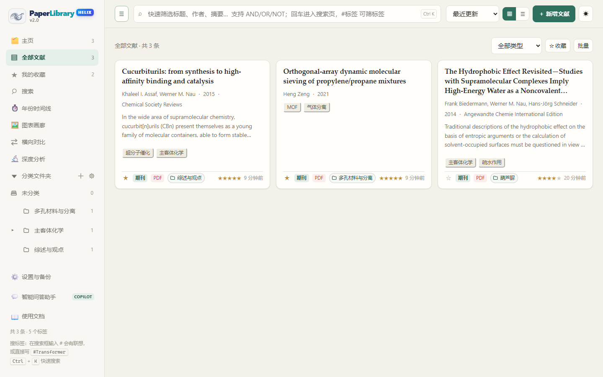

---

## 6. 导入文献

### 6.1 拖 PDF 或粘贴 DOI

点右上角 **`＋ 新增文献`**（或按 `N`）进入导入页：

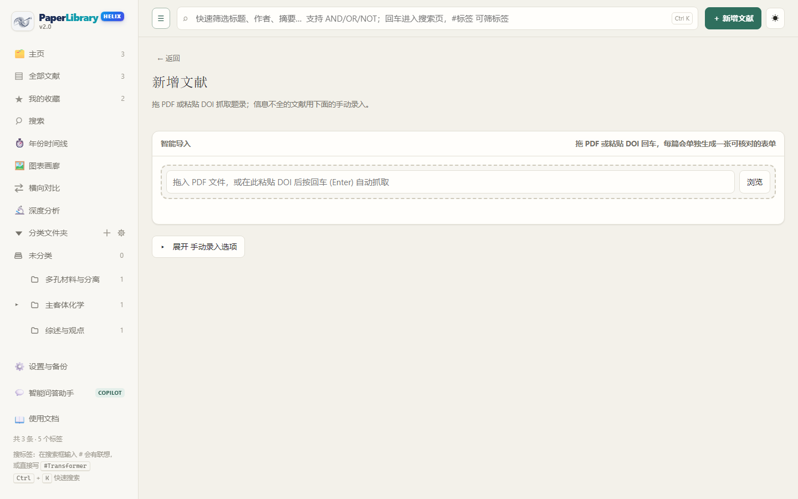

有两种方式：

- **拖入 PDF**：把一个或多个 PDF 拖到虚线框里，或点 `浏览` 选择文件。
- **粘贴 DOI**：把 `10.1039/c4cs00273c` 这样的 DOI 粘进输入框，按回车，程序会联网抓取题录。

每个文件会生成一张**可核对的卡片**，自动填好标题、作者、年份、类型、卷期页码、期刊、DOI、摘要等字段：

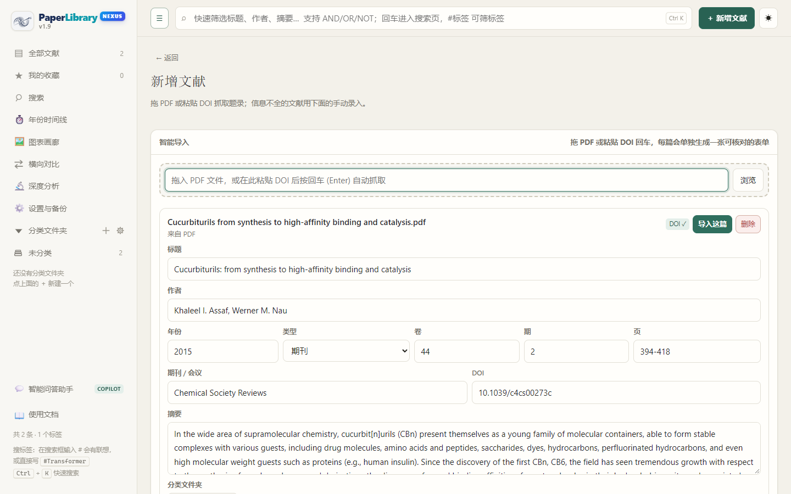

- 右上角的 `DOI ✓` 表示已识别出 DOI 并用于匹配书目记录，可点开核对。
- 字段可以直接改；缺的可以补。
- 点 `导入这篇` 入库；多个文件可以点 `全部导入`。
- 抓不到题录不是错误：把标题、年份补上照样能入库，只是没有 DOI 与自动摘要。

输入框下方的 `▸ 展开 手动录入选项` 可以只填最少字段快速建一条记录，适合先登记、之后再补。

> 单批最多 **200 个文件**；超过会提示分批导入。

### 6.2 把已有目录扫进库

如果你的 PDF 已经按文件夹整理好，可以放进 `data\article\papers\`，然后：

`设置与备份` → `资产与备份` → `原文与补充材料` → **`重新扫描`**

- 会**递归**扫描子目录，并按磁盘目录结构生成分类；直接放在根目录的 PDF 归入 `未分类`。
- 按文件内容去重；PDF 被移动或改名后，重扫能靠内容指纹找回原来的卡片。
- 扫描结果会显示新增、恢复关联、失败各多少篇。

### 6.3 导入 JSON 备份（换电脑 / 恢复）

`设置与备份` → `资产与备份` → `导出与备份` → `选择 JSON 文件…`

支持本程序导出的 JSON（也接受任何含 `papers` 数组的同结构文件），选完会让你挑**合并**或**覆盖**。

> JSON 里是题录、标签、AI 总结与对话记录，**不包含 PDF 原文**。要连原文一起迁移，请复制整个 `data/` 目录（见第 14 节）。

---

## 7. 整理与分类

### 7.1 分类就是磁盘上的文件夹

左侧 `分类文件夹` 与主页的文件夹卡片，都直接读取 `data\article\papers\` 下的真实目录：

- **主页**列顶层文件夹卡片；卡片上的「1 篇」是「直接放在这里」的篇数，子文件夹名以小标签显示。
- 点卡片 `进入` 后，列表只剩该目录的文献，下方是下一级子文件夹卡片；顶部 `← 返回 / 主页` 面包屑可逐级回退，`含子文件夹` 开关决定是否把子目录的文献一起列出。
- 根目录下的 PDF 归入 `未分类`。
- 支持嵌套目录和空目录；同级分类可以拖拽调整顺序，顺序会记住。
- 在资源管理器里建文件夹、移动 PDF 后，回到 `设置 → 资产与备份 → 原文与补充材料 → 重新扫描` 同步即可（递归识别目录，按内容指纹去重）。

常用操作：

| 操作 | 位置 |
| --- | --- |
| 新建分类 | `分类文件夹` 标题旁的 ＋，或 `新建文件夹` |
| 重命名 / 删除 | `管理文件夹`（✎ / 🗑） |
| 改单篇分类 | 列表卡片上「文件夹」按钮；或详情页 `更改` |
| 批量移动 | 列表顶部 `批量` → 勾选 → 底部 `移动到目录` |
| 折叠目录树 | 点 `分类文件夹` 标题旁的小三角 |

删除分类不会删除文献：目录里的文献会回到上一级。

### 7.2 编辑题录

在详情页点右上角 **`⋯`** → **`✎ 编辑文献`**。可改：

- 标题（必填）、作者（一行一个或逗号分隔）、年份、类型
- 期刊/会议、卷、期、页码、DOI、链接、出版社、BibTeX 键
- 标签、分类文件夹、原文关键词、摘要
- 收藏、我的评分、替换 PDF 原文

改完点 `保存修改`（或 **Ctrl + S**）。

### 7.3 标签、收藏与评分

- 详情页 `＋ 添加标签`；列表卡片会显示标签胶囊。
- 搜索框输入 `#标签` 可直接筛；输入 `#` 会出联想。
- `加入收藏` 后出现在侧栏 `我的收藏`；评分可在列表按 `评分 ↓` 排序。

### 7.4 补充材料（SI）

详情页右侧 `补充材料` → `＋ 上传`。支持 PDF、Word（DOC/DOCX）、RTF、Excel（XLSX）、TXT/CSV/TSV/Markdown 等；不能解析正文的格式仍会保存原件并给出下载入口。

PDF 补充材料会在阅读区新开标签页，和原文并列；**每份 PDF 的页码、缩放、荧光笔和便签分别保存**。

---

## 8. 检索

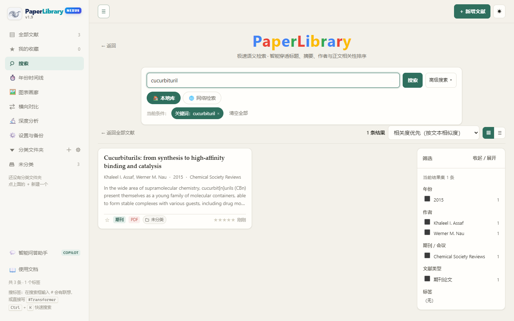

侧栏 `搜索` 进入完整搜索页；顶部搜索框输入后回车也会到这里。

### 8.1 直接写关键词

- 普通词：在标题、作者、摘要、期刊、笔记等题录字段中模糊匹配。
- 多个词默认按「都要命中」处理。
- **AND / OR / NOT**（也认 `&&` `||` `!`，中文 `与 / 或 / 非`）组合。
- 引号里的短语整体匹配。
- `#标签`：例如 `#超分子催化`。
- 字段限定：`author:Smith year:2023 journal:Nature`、`title:"host-guest"`、`doi:10.1039/...`；年份可写区间 `year:2020-2024`。
- 需要搜 PDF 正文时写 `fulltext:关键词`，或按下一节切换检索范围。

布尔组合的写法示例：

```text
cucurbituril AND (catalysis OR sensing)
(cage OR capsule) NOT porphyrin
```

### 8.2 高级搜索：按条件组合

点 `高级搜索` 展开，可填作者、期刊/会议、年份范围、类型、原文关键词，并选择**检索范围**：

- `题录与摘要（标题、作者、摘要）`
- `PDF 全文正文`
- `两者都搜（推荐）`

还能勾选 `我的标签`、`只看收藏的`、`只看有 PDF 的`。填好后点 `开始搜索`。

> 全文检索依赖正文已提取。导入 PDF 后通常会自动提取；没有正文时，可在详情页点 `识图识别全文` 或重新关联文件。

### 8.3 结果筛选

结果右侧的 `筛选` 面板会按当前结果集列出年份、作者、期刊、类型、标签的分布，多选即可继续收窄；`收起 / 展开` 可折叠。

### 8.4 网络检索（可选）

搜索页顶部有 `本地库` / `网络检索` 两个范围。网络检索使用 OpenAlex（题录）与 Exa（网页），需要在 `设置与备份 → API服务` 里单独配置 Key，按各自额度计费；不配置不影响本地检索。

---

## 9. 读一篇文献

点任意文献卡片进入详情页：

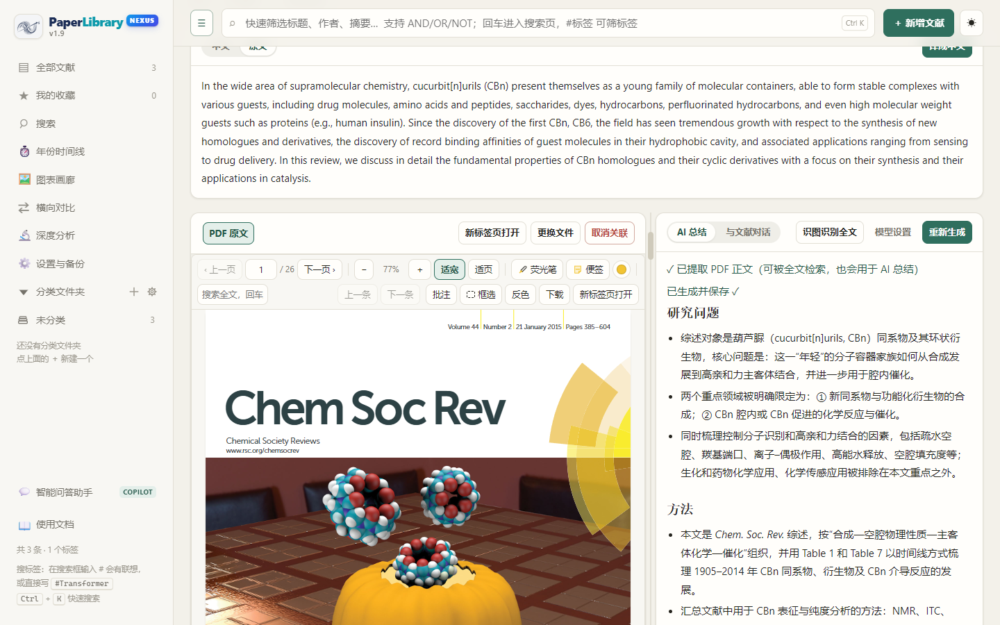

页面分三段：

1. **题录区**：标题、作者、DOI、标签，以及 `引用`、`查看 PDF`、`图表`、`对比`、`深度分析` 按钮；右上角 `⋯` 还有编辑、导出、打开 DOI、删除。
2. **摘要区**：`中文` / `原文` 切换，`译成中文` 按钮。
3. **阅读区**：左侧 PDF 阅读器，右侧 `AI 总结` / `与文献对话` 面板，中间的分隔条可以拖动调整宽度。

### 9.1 PDF 阅读器

- 页码跳转、`−` / `＋` 缩放、`适宽` / `适页`
- 文本搜索，`上一条` / `下一条` 跳转
- `荧光笔`、`便签`、`批注颜色`、`框选`、`反色`
- `下载` / `新标签页打开`
- `更换文件` / `取消关联`

原文和每份 PDF 补充材料分别保存批注，切换标签会恢复各自的页码与缩放。

### 9.2 AI 总结（需配置大模型）

右侧 `AI 总结` → `生成总结`。生成后会保存缓存，下次直接显示；按钮变为 `重新生成`。

总结会读取这篇的**正文与补充材料**，按你在设置里配置的提示词输出结构化中文内容（默认包含「研究问题 / 方法 / 主要结论 / 对我的价值」四节）。面板底部会显示读入了多少字、多少份 SI，以及生成时间。

没有配置模型时，这里会显示「还没有生成总结」，`模型设置` 会跳到 `设置 → API服务 → 大模型`。

### 9.3 与文献对话（需配置大模型）

切到 `与文献对话`：

- 直接提问，例如「这篇的循环稳定性测了多少圈、什么条件？」「把实验步骤按 1/2/3 列出来」。
- `🖼 图片`：贴图提问（框选图表截图，让它解释）。
- `联网搜索`：勾选后允许查外部资料（需要 Exa 配置）。
- 资料来自：正文 + 补充材料 + 本库检索 + 联网检索；提问历史会保存，可回看。
- 题录区 `⋯` → `导出 AI 总结与对话（PDF）` 可生成打印视图。

> AI 的输出是生成结果，重要数字、结论与参考文献请回原文核对。

### 9.4 识图与图表

- `识图识别全文`（需配置支持图片的模型）：把扫描件的每一页渲染成图片交给模型抄录，**每页大约一次模型调用**；识别结果会存成这篇的正文，之后可全文检索、生成总结与问答。
- `图表`：提取这篇的图与表，进入图表画廊按篇查看。

---

## 10. 引用与导出

### 10.1 一键引用

详情页点 `引用`，选格式后点 `复制`：

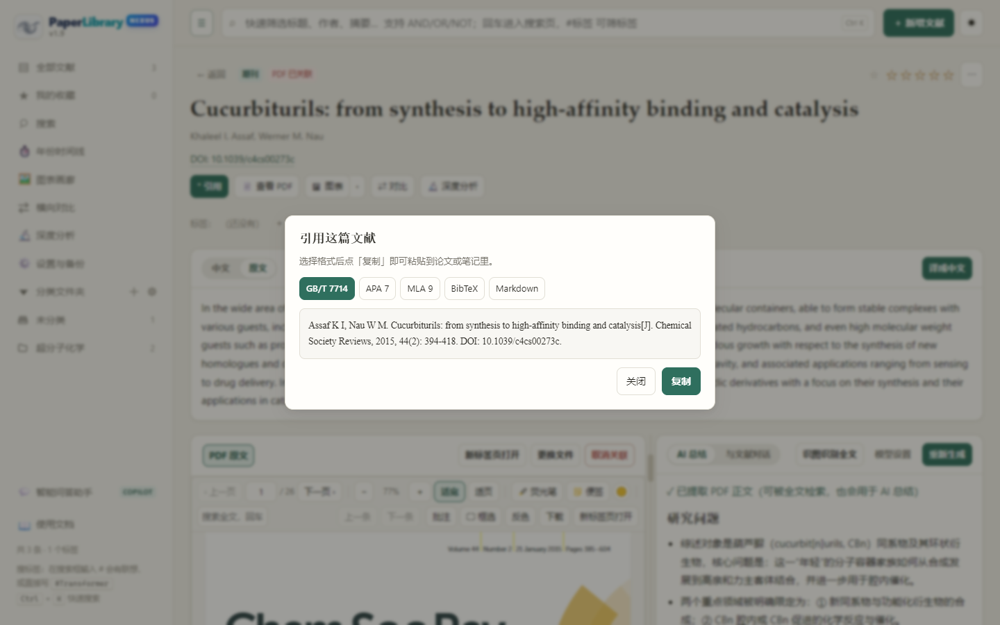

支持 **GB/T 7714、APA 7、MLA 9、BibTeX、Markdown** 五种格式，自动带上 DOI 与卷期页码。

### 10.2 整库导出

`设置与备份` → `资产与备份` → `导出与备份`：

| 按钮 | 产出 | 适合 |
| --- | --- | --- |
| `导出全部（JSON 备份）` | `papers` 数组的完整存档 | 换电脑、误删恢复 |
| `导出 BibTeX（.bib）` | BibTeX 条目 | Zotero / EndNote / LaTeX |
| `导出 Markdown（.md）` | 每篇一节的 Markdown | 笔记软件、Git 仓库 |

JSON 包含题录、标签、AI 总结与对话记录，但不含 PDF 原文。

---

## 11. 图表、对比与深度分析

### 11.1 图表画廊（FigureLens）

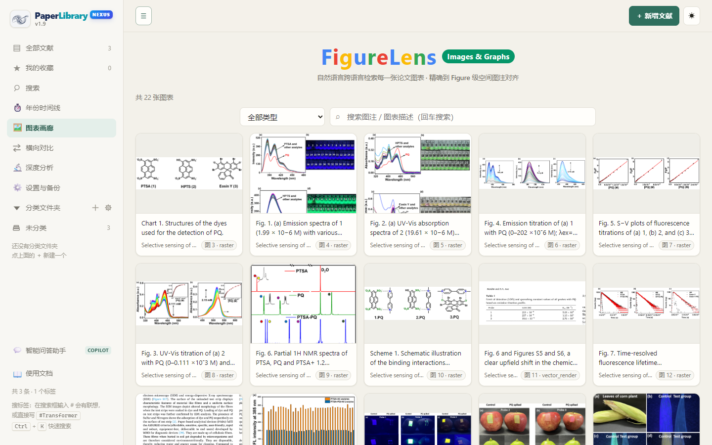

侧栏 `图表画廊` 汇总从各篇 PDF 提取的图与表：

- 顶部可按类型筛：插图（figure）/ 表格（table）/ 路线（scheme）/ 图表（chart）。
- 搜索框按图注、图表描述检索。
- 点任意一张图会跳到原文对应页；卡片下方标注来源文献与页码。

### 11.2 横向对比

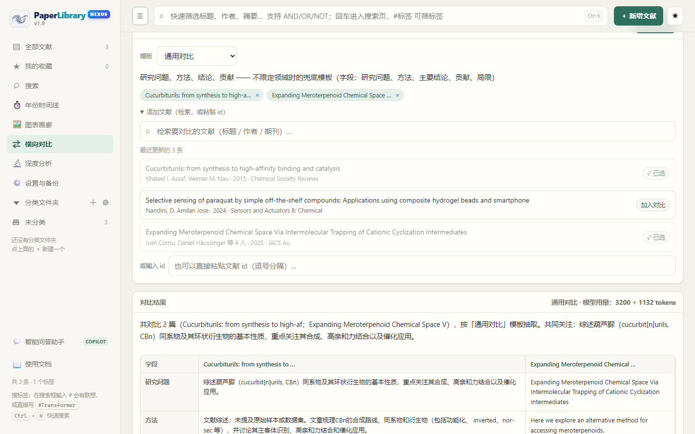

侧栏 `横向对比`：

1. 选 **2–8 篇**文献（按标题/作者/期刊检索，或粘贴文献 id）。
2. 选模板：`合成路线对比`、`电化学性能对比`、`材料与表征对比`、`通用对比`。
3. 点 `开始对比`，生成同字段并排的表格。

结果会注明所用模板与模型 token 用量。没有配置大模型时会退化为「本地对比」，只填能从题录直接得到的字段。

### 11.3 深度分析

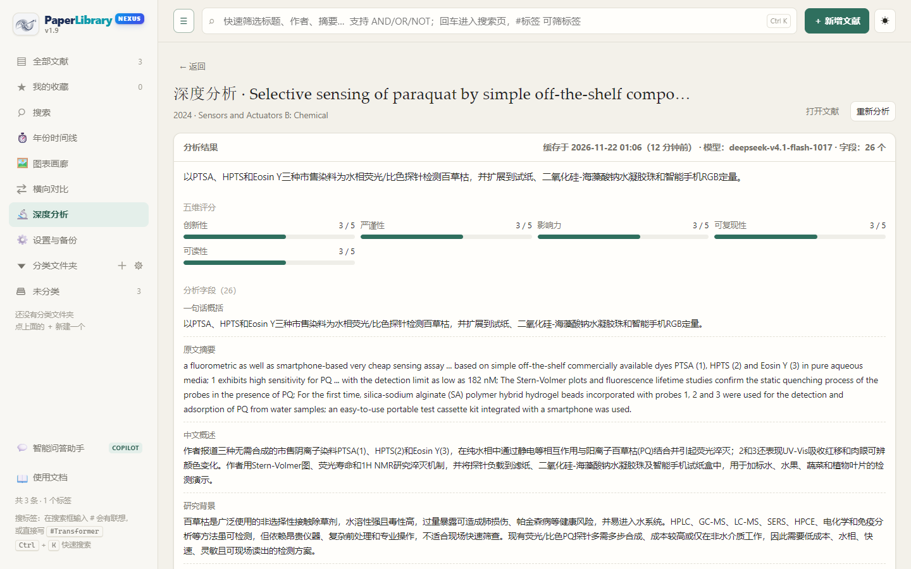

侧栏 `深度分析` 或详情页 `深度分析`：

- 对单篇文献抽取结构化字段（分析问题、方法、结论、证据强弱、局限、相关工作、开放问题等），并给出**五维评分**（创新性、严谨性、影响力、可复现性、可读性）。
- 结果缓存在本地，第二次打开直接显示，可点 `重新分析`。
- 页面会标注分析模式（大模型 / 本地）与模型名。

### 11.4 年份时间线

`年份时间线` 按年份列出库藏与统计，可点 `打印 / 存 PDF` 留存。

---

## 12. 设置、备份与更新

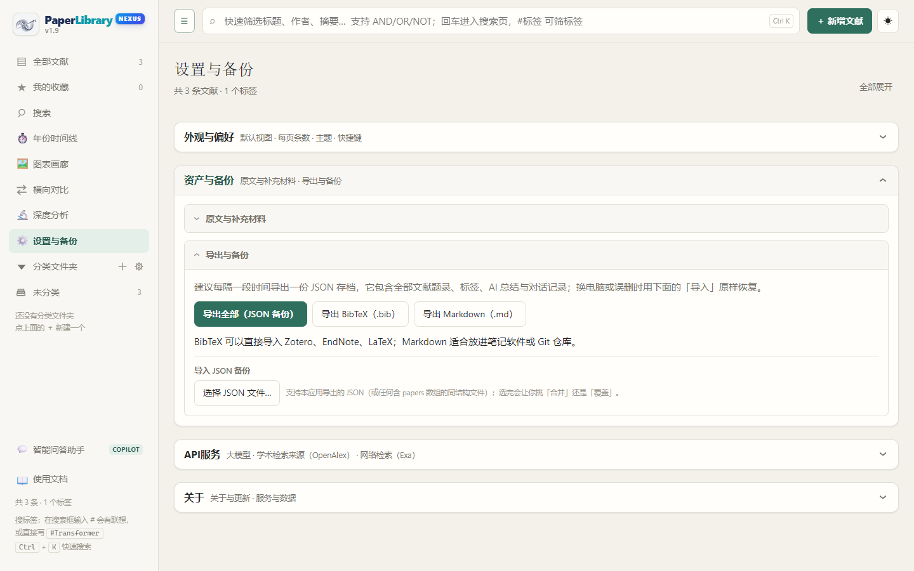

侧栏 `设置与备份` 分四栏，默认只展开第一栏；点栏名展开/收起，右上角可 `全部展开`。栏内还会再分小面板。

### 12.1 外观与偏好

- 默认视图（卡片 / 紧凑列表）、每页条数（20 / 30 / 50 / 100）、主题（纸感浅色 / 夜间深色）。
- 快捷键一览：`Ctrl+K` 搜索、`N` 新增、`T` 主题、`Ctrl+S` 保存表单。

### 12.2 资产与备份

- `原文与补充材料`：`重新扫描`、`重整文件名（原文 + 补充材料）`；列出已关联/未认领/重复副本，并可清理重复。
- `导出与备份`：JSON / BibTeX / Markdown 导出；`选择 JSON 文件…` 导入备份（合并或覆盖）。

### 12.3 API 服务（可选）

- `大模型`：服务商（DeepSeek / Claude / OpenAI / Kimi / 通义千问 / 本地 Ollama）、模型名称、接口地址（baseURL）、API Key、温度、最大输出、提示词，以及「新增文献后自动生成中文一句话总结」开关。填完可 `保存并测试连接`。
- `学术检索来源（OpenAlex）`：填 Key 可提升额度；不填走共享 IP。
- `网络检索（Exa）`：联网检索与对话联网开关，按量计费，可设本月花费上限。

> API Key 在本机加密保存（Windows DPAPI，绑定当前 Windows 账户与这台机器；Exa 在 `websearch.json`，OpenAlex 在 `sources.json`）。换账户或换机器后需要在设置里重填。不要把 `data/` 发给别人或提交到 Git。

### 12.4 关于与更新

- `关于与更新`：当前版本、`检查更新`、`回看更新公告`；「启动后自动检查更新」默认开启（只通知，不下载），「自动下载更新」默认关闭。
- **更新流程**：检查更新 → 下载（边下边校验字节与 SHA-256）→ `立即安装`。安装只替换程序文件，`data\` 原样保留；中途失败会按 journal 记录回滚到旧程序。
- 不想让它自动装，也可以去 Releases 下载整包解压覆盖，效果相同、数据不动。
- `服务与数据`：数据目录、文献统计、运行时长、PID 与自动停止说明。要停服务，关掉窗口即可；命令行方式用 `--stop --port <端口>`。

新版本第一次启动会弹一次开屏公告（版本更新说明 + `不再提示此公告`），之后可以从上面的 `回看更新公告` 再打开：

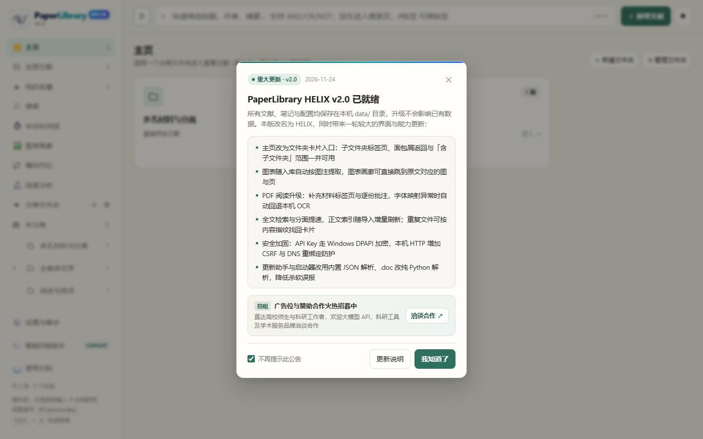

---

## 13. 智能问答助手与使用文档

### 13.1 智能问答助手

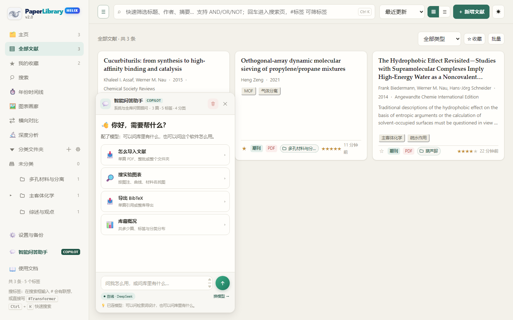

入口在左侧栏底部、`使用文档` 上方。点一下在左下角弹出面板，再点入口、点 `✕` 或按 `Esc` 收起。

- **未配置大模型**：离线引导模式，提供四条上手路径（导入、搜图、导出、库藏概况）和常用问题检索，不联网、不花钱。
- **已配置大模型**：智能问答模式，会先检索库内文献，再结合使用说明回答；涉及库内文献时会列出「引用来源」，可点进对应文献。
- 面板里可 `清空对话`；对话不会写进单篇文献的对话历史。

### 13.2 使用文档（应用内手册）

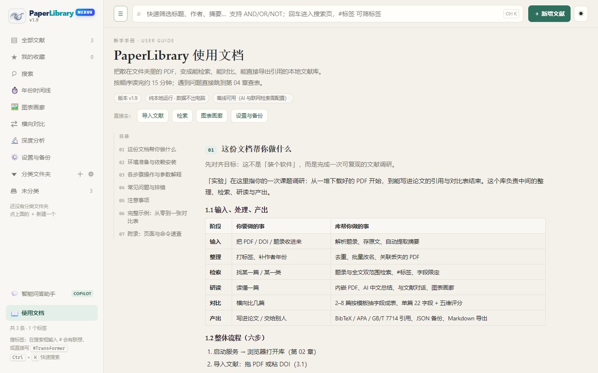

侧栏 `使用文档` 是应用内的完整新手手册，包含：目标、环境准备、逐步操作、常见问题、注意事项、完整示例、页面与命令速查。遇到不清楚的按钮，先来这里搜一下。

发布包根目录的 `使用说明.txt` 是同一套内容的精简文字版，适合不方便打开程序时查阅。

---

## 14. 数据、备份与隐私

### 14.1 数据都在 `data/`

第一次启动只会创建库文件与基础目录；下表里的配置与缓存会在用到时才出现。

| 路径 | 内容 |
| --- | --- |
| `data\library.db` | SQLite 单文件数据库：题录、标签、收藏、笔记、批注、对话、分析缓存 |
| `data\article\papers\` | PDF 原文，按分类目录存放 |
| `data\article\attachments\` | 补充材料（SI） |
| `data\fulltext\` | 正文提取缓存 |
| `data\images\` | 从 PDF 提取的图表 |
| `data\prefs.json` | 界面偏好 |
| `data\settings.json` | 大模型配置（含 API Key，明文） |
| `data\websearch.json` | Exa 配置 |
| `data\sources.json` | OpenAlex 配置 |
| `data\backups\` | 自动备份与清理出的重复副本 |
| `data\logs\` | 启动与服务日志（排错先看 `launcher.log`） |
| `data\updates\` | 更新下载、暂存与安装日志 |
| `data\webview2\` | 内置窗口缓存，可删除（会重置窗口偏好） |

### 14.2 怎么备份 / 迁移

- **最稳妥**：关闭窗口后，把整个 `data\` 目录复制一份（含 PDF 原文）。换电脑时整目录拷过去即可。
- **轻量**：`设置 → 资产与备份 → 导出与备份 → 导出全部（JSON 备份）`，换机后导入。JSON 不含 PDF 原文。
- 程序升级不会动 `data/`。

### 14.3 隐私

- 默认只监听 `127.0.0.1`，同一局域网也访问不到；只有显式加 `--host 0.0.0.0` 才会对外开放（不建议）。
- 不注册、不登录、不上传；只有你主动点 AI 总结/对话或联网检索时，相应文本才会发给你配置的服务商。
- `data/` 里可能有 API Key 与你尚未发表的笔记，分享程序目录前请删除 `data/`（以及任何包含 `data/` 的打包）。

> **不要把 `data/` 放进 OneDrive / 坚果云等实时同步目录**：SQLite 在同步过程中被并发写入容易损坏。需要备份就手动整目录复制或导出 JSON。

---

## 15. 常见问题

| 现象 | 原因 | 处理 |
| --- | --- | --- |
| 双击 `PaperLibrary.exe` 没反应 / 弹错误框 | 启动失败，或 4321 被别的程序占用 | 看 `data\logs\launcher.log` 最后几行；确认 4321 空闲；确认 WebView2 已安装 |
| 窗口一片空白或一直显示「正在打开」 | WebView2 运行时异常，或页面没加载完 | 稍等几秒；不行就关掉窗口重开；仍空白则检查 WebView2 是否安装 |
| 提示「端口 4321 已被其它程序占用」 | 启动器固定用 4321 | 关掉占用程序；或改用命令行起服务：`runtime\portable\python.exe -m paperlib --port 4322 --no-open`，再访问 `http://127.0.0.1:4322/` |
| 浏览器访问 `http://127.0.0.1:4321/` 打不开 | 服务没在运行，或不在 4321 | 先双击启动；确认地址与端口一致 |
| 关掉窗口后服务还在运行 | 该服务不是本次窗口启动的（例如你先用命令行起过服务），启动器只是连上去 | 用 `runtime\portable\python.exe -m paperlib --stop --port 4321` 停止 |
| 用着用着服务自己退了 | 关掉了内置窗口；或浏览器方式下关掉了所有页面、30 秒自动停机 | 重新双击；浏览器方式下不想自动停，启动时加 `--idle-exit 0` |
| Windows 提示「无法验证发布者」/ SmartScreen | 发布包未做代码签名 | 右键 zip → 属性 → 解除锁定后再解压；已弹出时点「运行」 |
| AI 总结按钮没反应或报错 | 没配模型、Key 无效、网络不通 | `设置 → API服务 → 大模型` 填好 Base URL / Key / 模型名，点 `保存并测试连接` |
| 对话答得很空 | 这篇没有正文（只有题录） | 重新关联 PDF，或点 `识图识别全文` 提取正文后再问 |
| 搜不到正文里的词 | 检索范围停在「题录与摘要」 | 搜索页 `高级搜索` → 检索范围改为「PDF 全文正文」或「两者都搜」 |
| 扫描版 PDF 搜不到内容 | PDF 是图片，没有文本层 | 配置模型后，在详情页点 `识图识别全文`（逐页识别，按页计费）再搜 |
| 同一篇出现了两条记录 | 一次按 DOI、一次按 PDF 导入 | 在列表里删除多余的一条；如果只是文件重复，`设置 → 资产与备份 → 原文与补充材料` 会列出重复副本并可清理 |
| 输入中文标签没反应 | 标签必须带 `#` 前缀 | 输入 `#超分子催化`，等联想出现再回车 |
| 换电脑怎么迁移 | 数据都在 `data/` | 关闭程序后拷整个 `data/`；或导出 JSON 再在新机导入（不含 PDF） |
| 公式显示成源代码 | KaTeX 资源缺失时会降级 | 不影响文献功能；重新解压完整发布包即可恢复 |
| 想清空试用数据 | `data/` 是唯一真源 | 关闭程序后删除整个 `data/`，重启得到空库 |

---

## 16. 版本与许可

- 版本以程序内「设置与备份 → 关于」和根目录 `version.json` 为准；更新记录与安装包见 [GitHub Releases](https://github.com/PaperLibrary-Developers/PaperLibrary/releases)。
- 本版要点（代号 **HELIX**）：主页改为分类文件夹卡片入口并支持子文件夹标签页、图表按图注自动提取与定位、PDF 补充材料标签页与逐份批注、检索与分面提速（正文索引增量刷新）、API Key 改用 Windows DPAPI 加密、本机 HTTP 增加 CSRF 与 DNS 重绑定防护。
- 更新方式：`设置与备份 → 关于 → 关于与更新 → 检查更新`，下载后点 `立即安装`（安装会保留 `data/`）。
- 许可证：[GNU Affero General Public License v3.0](LICENSE)。

---

## 附：截图说明

本 README 的界面截图由无头浏览器（Edge headless，1440 × 900）从当前源码运行的实际界面自动截取；演示库是 3 篇公开论文，AI 相关画面里的总结、对比表与深度分析均为真实模型输出（deepseek-chat）：

| 截图 | 对应页面 / 状态 |
| --- | --- |
| `01-home.png` | 主页：分类文件夹卡片入口（含子文件夹标签） |
| `01b-all.png` | 全部文献：整库卡片列表与标签 |
| `02-import.png` | 新增文献（导入页）空白状态 |
| `03-import-check.png` | 拖入 PDF 后解析出的题录卡片（含 DOI 校验与「库里可能已有这篇」提示） |
| `04-detail.png` | 详情页：左侧 PDF 阅读器，右侧 AI 总结 |
| `05-cite.png` | 引用格式弹窗（GB/T 7714 选中） |
| `06-search.png` | 搜索页：关键词 `cucurbituril` 的本地结果与分面筛选 |
| `07-figures.png` | 图表画廊（FigureLens）：入库自动提取的图表 |
| `08-compare.png` | 横向对比：通用对比模板生成的结果表 |
| `09-deep.png` | 深度分析：五维评分与结构化字段 |
| `10-settings.png` | 设置 → 资产与备份 → 导出与备份 |
| `11-copilot.png` | 智能问答助手面板（已配置模型，在线模式） |
| `12-guide.png` | 应用内「使用文档」 |
| `13-notice.png` | 开屏公告：版本更新说明与「不再提示此公告」 |
