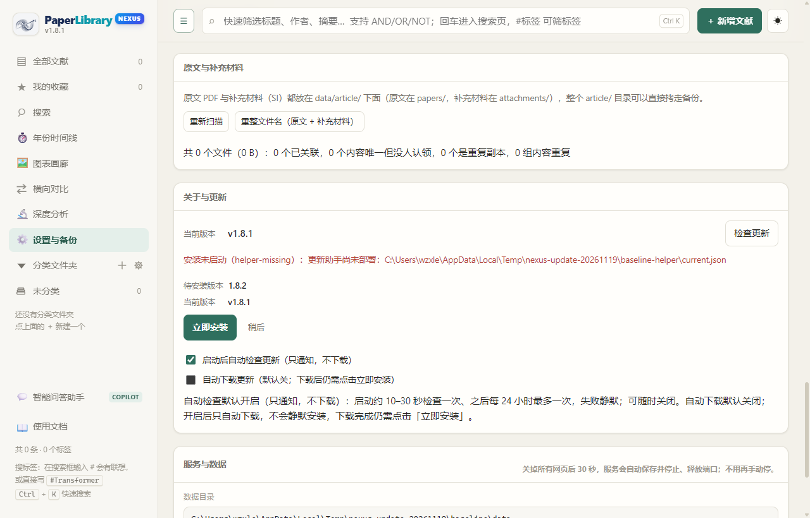

# 文献库安装更新失败与关窗受阻修复报告

2026-11-19（日本时间）

## 复现

使用原版 Windows v1.8.1 发布包，在临时目录运行 WebView2 客户端，并将包外更新助手指向独立的空目录。使用仓库的下载验证与解包代码离线准备正式 v1.8.2 更新包。正式签名清单、包大小和 SHA-256 检查通过，暂存状态为 `ready`。设置页点击、后端写入安装请求和启动器预检均走产品原有入口。

1. 打开「设置与备份 → 关于与更新」，确认显示待安装 v1.8.2。点击「立即安装」，再点击「立即安装并关闭」。[更新已就绪](01-baseline-ready.png) · [安装确认框](02-baseline-confirm.png)
2. 设置页显示「安装未启动（helper-missing）：更新助手尚未部署」。此时 `data/updates/apply.json` 已写入，包外目录没有 `current.json`，启动器日志记录 `precheck=helper-missing ok=False`。[设置页报错](03-baseline-helper-missing.png)
3. 按 Alt+F4。「否」关闭了提示框，应用窗口仍开着。「是」重新走安装预检，又报同一错误。两次尝试后，隔离客户端仍在运行。[原版关闭提示](04-baseline-close-prompt.jpg) · [关窗重试报错](05-baseline-close-failed.jpg)



## 根因与修复

| 根因 | 修复 |
|---|---|
| 正式 v1.8.1 和 v1.8.2 ZIP 都含更新助手、元数据和部署脚本。正常启动从未调用部署脚本，而 `LauncherCore.FindHelper` 直接读取包外的 `current.json`，因此干净环境预检失败。 | 启动器通过便携 Python 调用随包部署脚本，校验并部署助手，保留已校验的更高版本。预检遇到缺失或损坏的包外助手时尝试修复后重新预检。恢复优先使用现有已校验的助手。更新验证启动在安装提交后才部署新版助手。 |
| 设置页先写入 `apply.json`，然后请求启动器安装。旧版在发现该文件后先取消关窗。用户拒绝安装或重试失败时，关闭操作都被取消。 | 用户可选择关闭并安装、保留更新并关闭，或取消关窗。关窗时尝试安装失败也可以继续关闭。保留更新时走正常服务退出流程，并留下暂存包和安装请求供重试。 |

## 测试

| 验证项 | 结果 |
|---|---|
| Windows 桌面安装与自动重开 | 在 v1.8.1 隔离包中换入修复后的启动器与部署代码。首次启动从空目录部署助手，校验了包外文件的 SHA-256。随后移走 `current.json`，在设置页重新点击安装，启动器补建记录并通过预检。旧进程退出，正式 v1.8.2 自动重开，`state.json` 为 `success`，3 次健康检查通过。测试数据保留，数据库备份存在。 [自动重开后的设置页](08-fixed-updated-reopened.png) |
| 更新助手不可用时退出 | 在另一个隔离包中破坏包内 `helper.json`，观察到真实安装再次返回 `helper-missing`。按 Alt+F4 并选择重试，第二次报错时选择仍然关闭。应用进程退出，服务正常停止并释放端口 4321，`apply.json` 的 SHA-256 与退出前一致，暂存文件仍在。 [关闭选项](06-fixed-close-options.jpg) · [重试失败后仍可退出](07-fixed-close-after-failure.jpg) |
| Python 全量测试 | 共 728 项，727 通过，1 跳过，0 失败。新增回归覆盖 5 个关闭事件场景，以及校验通过的新版助手保留和损坏记录修复。 |
| Node 测试 | 15 通过，0 失败。 |
| API 契约 | 源码与解压包分别为 61 通过、0 失败、13 跳过。 |
| Windows 打包与冷启动 | PowerShell 7 下运行 `tools/check_windows.ps1 -PackageOnly` 通过。用同一代码构建并解压的修复包可在空助手目录冷启动，自动部署 v1.8.2 助手，`self-check` 的 6 项检查全部通过，随后正常退出。 |

桌面验收使用官方已签名的 v1.8.2 作为升级目标，修复代码作为发起安装的一端单独验证。全程使用隔离的程序、数据库与助手目录，未发布新版本。

## 已安装版本的临时恢复

当前已发布的旧客户端可在可信发布包中 `PaperLibrary.exe` 所在目录运行随包部署脚本。该脚本会校验并部署该包的助手，再回到设置页重试。已在 v1.8.1 与 v1.8.2 正式包的隔离目录验证脚本可写出有效的包外部署记录。

```powershell
.\runtime\portable\python.exe -X utf8 -B .\tools\deploy_updater.py
```
